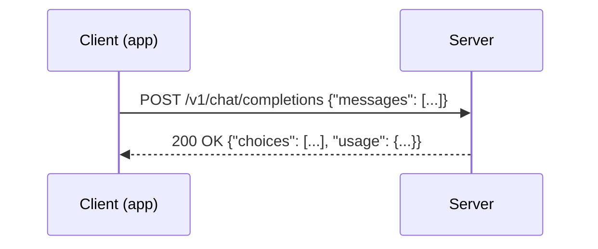
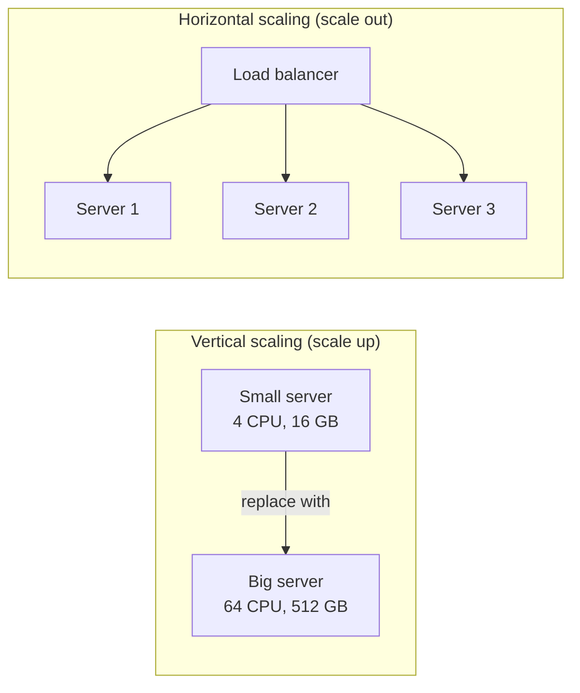
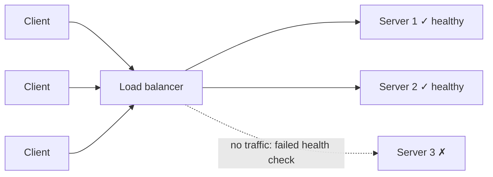
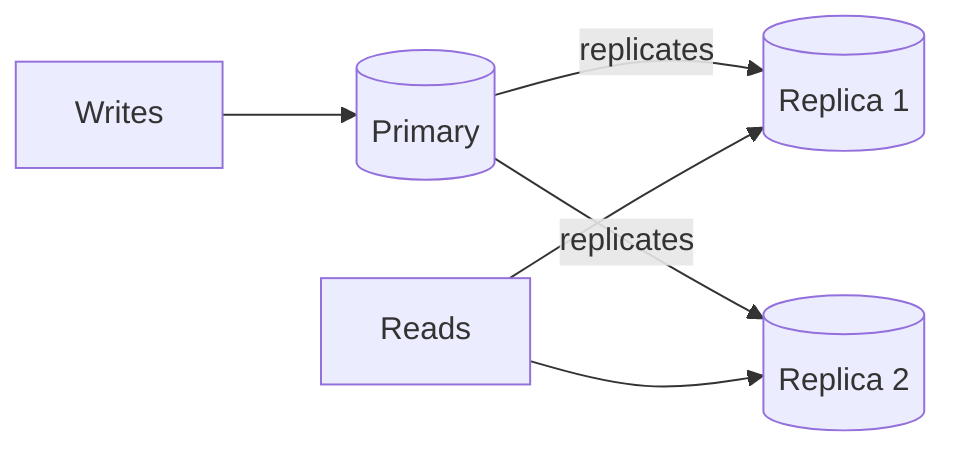
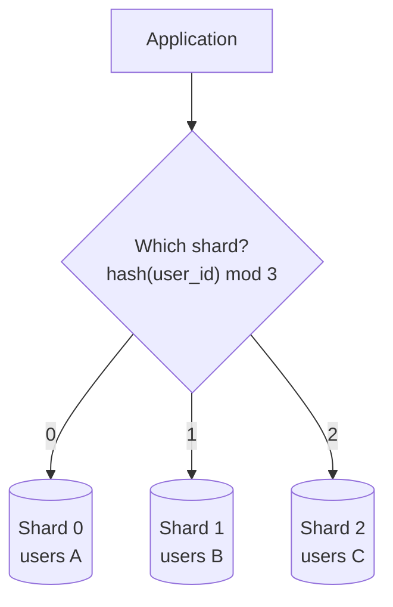
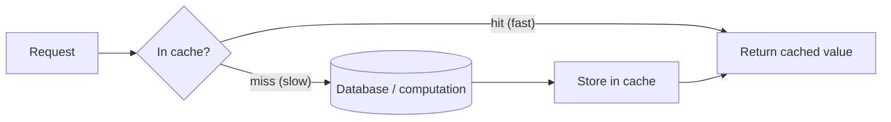
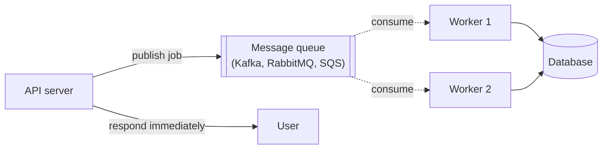
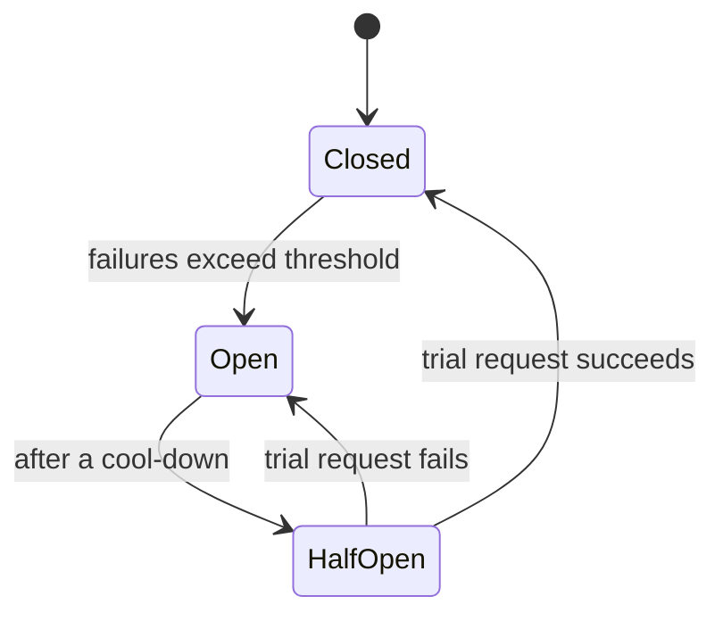

# 01 — Building blocks and definitions

**Every term you will hear in a system design interview, defined from scratch, drawn, and tied to an example.** Read it in order the first time: later sections use words defined in earlier ones.

For each idea you will find: **what it is**, **why it exists**, **a picture**, **an example**, and **the trade-off** — because in an interview, naming a component is worth little; saying what it costs is what earns credit.

---

## Part A — Describing a system

### A1. Client, server, request, response

- A **client** is the program that asks: a browser, a mobile app, another service, or a script calling an API.
- A **server** is the program that answers.
- A **request** is one question — "send me this page", "generate an answer" — and a **response** is one answer.
- An **API** (application programming interface) is the agreed set of requests a server accepts and the shape of what it returns.

### A2. Functional and non-functional requirements

- **Functional requirements** — *what* the system does. "Users can send a prompt and receive an answer." "Users can see their usage."
- **Non-functional requirements** — *how well* it does it. Latency, throughput, availability, durability, consistency, security, cost.

Interviews are mostly about the non-functional ones. "A chat API" is easy to design for one user; it is hard for a million users at 99.9% availability under a cost budget.

### A3. Latency

**Latency** is how long one request takes, from the client sending it to the client receiving the answer.

- Measured in milliseconds (ms) or seconds (s).
- **Never** describe latency with only an average. Use **percentiles**:
  - **p50** (median): half of requests are faster than this.
  - **p95**: 95% are faster; 1 in 20 is slower.
  - **p99**: 99% are faster; 1 in 100 is slower.

Example: 100 requests take 50 ms each, and 1 takes 10 s. The average is ~150 ms — which describes nobody. The p50 is 50 ms (most users) and the p99 is 10 s (the users who complain). Users experience the **tail** (p95/p99), which is why systems are designed around it.

For LLMs, latency has parts of its own: **time to first token (TTFT)** — how long until the answer starts appearing — and **time per output token (TPOT)** — how fast the answer streams after that.

### A4. Throughput

**Throughput** is how much work the system completes per unit of time: requests per second (**RPS** or **QPS**, queries per second), or for LLMs, tokens per second.

Latency and throughput are different things. A highway's *latency* is how long one car takes to cross it; its *throughput* is how many cars cross per hour. You can raise throughput (more lanes) without making any car faster.

### A5. Bandwidth

**Bandwidth** is how much data a link can carry per second — e.g. 1 Gbps (gigabit per second) ≈ 125 MB/s. A text API rarely runs out of network bandwidth; a video service does. (For LLMs, the bandwidth that matters is *memory* bandwidth inside the GPU — see the mock interview.)

### A6. Availability

**Availability** is the fraction of time the system works. It is usually written as "nines":

| Availability | Downtime per year | Downtime per month |
|---|---|---|
| 99% ("two nines") | 3.65 days (87.6 h) | 7.2 h |
| 99.9% ("three nines") | 8.8 h | 43 min |
| 99.99% ("four nines") | 53 min | 4.3 min |
| 99.999% ("five nines") | 5.3 min | 26 s |

Two rules for combining components:

- **In series** (a request needs *all* of them), availabilities **multiply** and the total gets *worse*: three components at 99.9% each → 0.999³ ≈ **99.7%**.
- **In parallel** (any *one* of them is enough), the chance that *all* fail multiplies, and the total gets *better*: two replicas at 99% each → 1 − 0.01² = **99.99%**.

That is the whole reason for redundancy.

### A7. Reliability, durability, fault tolerance

- **Reliability** — the system does the right thing, consistently. (A system can be available but unreliable: it answers, wrongly.)
- **Durability** — once data is saved, it is not lost. Storage services quote it in nines too, often 99.999999999% ("eleven nines") for object storage.
- **Fault tolerance** — the system keeps working when a part fails.
- **Single point of failure (SPOF)** — a component whose failure takes the whole system down. Finding and removing SPOFs is a standard interview step.

### A8. SLI, SLO, SLA, error budget

- **SLI** (service level *indicator*) — a measurement: "fraction of requests with TTFT under 1 s".
- **SLO** (service level *objective*) — a target for it: "99% over 30 days".
- **SLA** (service level *agreement*) — a contract with customers, with penalties: "if below 99.5%, you get credits". SLAs are looser than SLOs so you have a margin.
- **Error budget** — what the SLO allows to fail: 1% of requests in the example. Spend it on releases and experiments; when it is gone, focus on reliability.

---

## Part B — Scaling

### B1. Vertical and horizontal scaling

| | Vertical (scale up) | Horizontal (scale out) |
|---|---|---|
| How | a bigger machine | more machines |
| Easy? | yes — no code changes | needs a load balancer and stateless servers |
| Limit | the biggest machine money can buy | practically none |
| Failure | one machine = one failure point | one machine fails, others continue |

Start vertical (it is simpler), go horizontal when you hit the limit or need redundancy.

### B2. Stateless and stateful services

- A **stateless** server keeps nothing between requests: any server can handle any request. Easy to scale horizontally — just add copies.
- A **stateful** server remembers something (a session, a cache, an open connection), so a follow-up request must reach the *same* server, or the state must move.

**Design rule:** keep application servers stateless and put state in dedicated stores (databases, caches). Example: the OpenAI chat API is stateless — the client re-sends the whole conversation with every request — so any server can answer any turn.

### B3. Load balancer

A **load balancer (LB)** sits in front of a group of servers and spreads requests across them.

What it does:

- **Distributes load** with an algorithm:
  - *Round robin* — each server in turn. Fine when requests cost about the same.
  - *Least connections / least outstanding requests* — the server with the least work in flight. Better when costs vary (LLM requests vary 1000×).
  - *Hashing* (e.g. by user id) — the same user always goes to the same server; useful for caches.
  - *Power of two choices* — pick two at random, use the less busy one; nearly as good as least-connections, cheaper.
- **Health checks** — pings each server and stops sending to unhealthy ones.
- **Layer 4 vs layer 7** — an *L4* balancer forwards TCP connections without reading them (fast, simple). An *L7* balancer reads HTTP (paths, headers) and can route `/api/*` and `/admin/*` to different pools.

Trade-off: the LB itself can become a single point of failure — so it is run as a redundant pair, or as a managed cloud service.

### B4. Reverse proxy and API gateway

- A **reverse proxy** (nginx, Caddy, Envoy) sits in front of servers and handles shared chores: TLS (HTTPS), compression, caching, request size limits. A load balancer is usually a reverse proxy too.
- An **API gateway** is a reverse proxy specialised for APIs: authentication, rate limiting, request validation, routing to many backend services, usage metrics.

### B5. CDN (content delivery network)

A **CDN** is a network of servers around the world that caches static content (images, scripts, videos) close to users. A user in Mumbai gets the image from a Mumbai server instead of one in Virginia: lower latency, less load on your origin servers. Not useful for answers that are different every time — such as LLM generations.

---

## Part C — Storing data

### C1. Databases: SQL and NoSQL

| | SQL (relational) | NoSQL |
|---|---|---|
| Examples | PostgreSQL, MySQL, SQLite | key-value (Redis, DynamoDB), document (MongoDB), wide-column (Cassandra), graph (Neo4j) |
| Data model | tables with fixed columns, relations between them | flexible: keys, documents, columns |
| Strength | **transactions**, joins, strong consistency, ad-hoc queries | easy horizontal scaling, very high write rates, flexible schema |
| Choose when | data is relational and correctness matters (billing, accounts) | huge scale with simple access patterns (events, sessions, logs) |

An interview answer is not "NoSQL because it scales" but "PostgreSQL for accounts and billing because they need transactions; a wide-column store for usage events because we write billions of small rows and only read them by tenant and time".

### C2. ACID and transactions

A **transaction** is a group of operations that succeed or fail together ("move $10 from A to B" must not take from A without giving to B). **ACID** describes what a transaction guarantees:

- **Atomicity** — all or nothing.
- **Consistency** — the database moves from one valid state to another (constraints hold).
- **Isolation** — concurrent transactions do not see each other's half-done work.
- **Durability** — once committed, it survives crashes.

### C3. Indexes

An **index** is an extra data structure (usually a B-tree) that lets the database find rows without scanning the whole table — like the index at the back of a book. It makes reads fast and writes a little slower (the index must be updated too). Example: an index on `(tenant_id, timestamp)` makes "this tenant's usage this month" instant.

### C4. Replication

**Replication** keeps copies of the same data on several machines.

- **Leader–follower (primary–replica):** all writes go to the primary; replicas copy them and serve reads. If the primary fails, a replica is promoted (**failover**).
- **Synchronous** replication waits for replicas before confirming a write (safe, slower). **Asynchronous** does not (fast, but a crash can lose the last few writes, and replicas can be slightly behind — **replication lag**).
- Gains: read throughput, availability, durability. Costs: more machines, and replicas may serve slightly stale data.

### C5. Sharding (partitioning)

**Sharding** splits *one* dataset across several machines, each holding a part. Replication copies; sharding divides.

- **Shard key** — the field that decides where a row lives (user id, tenant id). Choose one that spreads load evenly and keeps related data together.
- **Hash sharding** spreads evenly; **range sharding** (by date, by name) keeps neighbours together but can create **hot spots** (everyone writes "today").
- Costs: queries across shards are expensive, and moving data when you add shards (**resharding**) is painful — which is what **consistent hashing** reduces.

### C6. Consistent hashing

With plain `hash(key) mod N`, adding one server changes `N` and moves almost every key. **Consistent hashing** places servers and keys on a ring; each key belongs to the next server clockwise. Adding or removing a server moves only the keys next to it — about 1/N of them. Used by distributed caches, databases and load balancers. A variant, **consistent hashing with bounded loads**, stops one server from getting too many keys.

### C7. Object storage and blob storage

**Object storage** (Amazon S3, Google Cloud Storage, Azure Blob) stores large files — images, backups, model weights — cheaply and very durably, addressed by a key. It is not a database: no queries, higher latency, but practically unlimited size. Model weights (gigabytes each) belong here; servers download them at start-up.

---

## Part D — Making things fast

### D1. Caching

A **cache** stores the result of an expensive operation so the next identical request is served quickly.

- **Hit rate** — fraction of requests served from cache. 90% hit rate means the database sees only 10% of the load.
- **Where:** in the browser, on a CDN, in the application's memory, or in a shared cache like **Redis** or **Memcached**.
- **Strategies:**
  - *Cache-aside* — the application checks the cache, and on a miss reads the database and fills the cache. The most common.
  - *Write-through* — writes go to the cache and the database together.
  - *Write-back* — writes go to the cache, the database is updated later (fast, risky).
- **Eviction** — when the cache is full, something is removed: **LRU** (least recently used) is the usual choice.
- **TTL** (time to live) — an entry expires after a set time, which bounds how stale it can get.
- **The hard part is invalidation** — making sure the cache does not serve outdated data after the source changes.

For LLMs there are two special caches: the **KV cache** (internal model state per conversation — see Part G) and the **prefix cache** (re-using that state when many requests start with the same text).

### D2. Asynchronous processing and message queues

Some work does not need to happen while the user waits: sending an email, resizing an image, aggregating usage for billing. Put it on a **message queue** and let **workers** do it later.

- **Producer** — publishes messages. **Consumer** / worker — processes them.
- **Decoupling** — the API stays fast and keeps working even if workers are slow or down; messages wait in the queue.
- **Absorbing bursts** — a spike of jobs fills the queue instead of overwhelming the database.
- **Delivery guarantees:**
  - *at-most-once* — may lose messages, never repeats.
  - *at-least-once* — never loses, may repeat → consumers must be **idempotent** (processing a message twice has the same effect as once).
  - *exactly-once* — usually achieved as "at-least-once + idempotency".
- **Dead-letter queue** — messages that keep failing go here for inspection instead of blocking the queue.

### D3. Batching

Doing several items of work together instead of one at a time — writing 1,000 rows in one database call, or (for LLMs) advancing many conversations in one pass of the model on the GPU. It raises throughput at the cost of a little latency per item.

---

## Part E — Protecting the system

### E1. Rate limiting

A **rate limiter** caps how many requests a client may make per time window, so one client cannot overwhelm the system or starve others. When the limit is hit, the server returns **HTTP 429 Too Many Requests** with a `Retry-After` header.

Common algorithms:

| Algorithm | Idea |
|---|---|
| **Token bucket** | a bucket holds up to *C* tokens and refills at *r* per second; each request takes a token. Allows bursts up to *C*. The most common. |
| Leaky bucket | requests queue and leave at a fixed rate; smooths traffic |
| Fixed window | count per calendar minute; simple, allows bursts at window edges |
| Sliding window | count over the last 60 s; accurate |

With many servers, counters live in a shared store (Redis) so the limit applies globally. Full design: [02-rate-limiting-and-quotas.md](../02-rate-limiting-and-quotas.md).

### E2. Backpressure, load shedding, admission control

When load exceeds capacity, something must give.

- **Backpressure** — a slow component signals upstream to slow down (a full queue makes producers wait).
- **Load shedding** — deliberately reject some requests (fast 429/503) so the rest stay fast.
- **Admission control** — deciding at the door whether to accept a request, usually with a **bounded queue**: accept while the queue has room, reject when full.

The insight: an unbounded queue under overload makes *everyone* slow; a bounded queue keeps accepted requests fast and tells the rest to retry. Full design: [03-admission-control.md](../03-admission-control.md).

### E3. Timeouts, retries, backoff, circuit breakers

- **Timeout** — stop waiting after a set time. Every network call needs one.
- **Retry** — try again after a transient failure. Only safe for **idempotent** operations.
- **Exponential backoff with jitter** — wait 1 s, 2 s, 4 s, 8 s… plus a random amount, so thousands of clients do not retry in sync (a **retry storm**).
- **Circuit breaker** — after many failures, stop calling a broken dependency for a while and fail fast, instead of piling up waiting requests.

### E4. Idempotency

An operation is **idempotent** if doing it twice has the same effect as doing it once. "Set balance to 100" is idempotent; "add 10 to balance" is not. Make non-idempotent APIs safe to retry with an **idempotency key**: the client sends a unique id, and the server remembers which ids it has already processed.

### E5. Authentication and authorisation

- **Authentication (authn)** — *who are you?* API keys, OAuth tokens, JWTs, mTLS.
- **Authorisation (authz)** — *what may you do?* Roles, scopes, permissions.

Every other control — rate limits per user, billing, isolation — depends on knowing who is calling. Full design: [01-authentication.md](../01-authentication.md).

---

## Part F — Distributed systems theory

### F1. Consistency models

When data has several copies, **consistency** is about what a reader can see.

- **Strong consistency** — every read sees the latest write. Simple to reason about; slower, and harder to keep available during failures.
- **Eventual consistency** — copies may disagree briefly, but converge if writes stop. Fast and highly available; readers may see stale data.
- **Read-your-writes** — a user always sees their own updates, even if others see them later. A common middle ground.

Example: a bank balance needs strong consistency; a "likes" counter can be eventually consistent.

### F2. The CAP theorem

In a distributed system, a **network partition** (P) — machines unable to talk to each other — will eventually happen. When it does, you must choose:

- **Consistency (C):** refuse requests that might return stale data, or
- **Availability (A):** keep answering, accepting that some answers may be stale.

So the practical choice is **CP** (e.g. a bank ledger, a configuration store) or **AP** (e.g. a shopping cart, a social feed). **PACELC** extends it: *even without* a partition (E), you trade **latency (L)** against **consistency (C)** — synchronous replication is consistent but slower.

### F3. Consensus and leader election

How several machines agree on one value (who the leader is, what the latest configuration is) despite failures. Algorithms: **Raft**, **Paxos**. You rarely implement them — you use systems built on them (etcd, ZooKeeper, Consul) — but you should know they exist and need a **quorum** (a majority, e.g. 3 of 5) to make progress.

### F4. Observability

How you know what a running system is doing:

- **Metrics** — numbers over time (requests per second, error rate, p95 latency). Prometheus, Datadog.
- **Logs** — events with details. Useful for debugging single requests.
- **Traces** — one request's path through many services, with time spent in each. OpenTelemetry, Jaeger.

Plus **alerts** on metrics that indicate users are affected, and **dashboards**.

---

## Part G — Definitions for ML and LLM serving

These are the terms that distinguish an LLM serving interview from a classic one.

| Term | Definition |
|---|---|
| **Model / weights** | the learned numbers; a 7B model has 7 billion parameters ≈ 14 GB at 16-bit precision |
| **Inference** | running a trained model to produce an output (as opposed to *training* it) |
| **Token** | the unit an LLM reads and writes — roughly ¾ of an English word; 1,000 tokens ≈ 750 words |
| **Prompt / input tokens** | what the user sends, including system instructions and conversation history |
| **Completion / output tokens** | what the model generates |
| **Context window** | the maximum prompt + output tokens a model can handle at once (e.g. 8k, 128k) |
| **Prefill** | processing the whole prompt in one parallel pass — compute-heavy; sets the time to first token |
| **Decode** | generating output one token at a time — each step reads all the weights from memory, so it is limited by **memory bandwidth** |
| **TTFT** | time to first token: queueing + prefill. What users feel as "responsive" |
| **TPOT / ITL** | time per output token / inter-token latency: the streaming speed after the first token |
| **Tokens per second** | per stream (one user's speed) or aggregate (the whole server's output) |
| **KV cache** | memory that stores attention state for each conversation so the model does not recompute the whole prompt for every new token; grows with context length and with the number of concurrent conversations — often the factor that limits concurrency |
| **Prefix cache** | re-using the KV cache when many requests share the same beginning (a system prompt) — skips most of the prefill |
| **Batching (continuous)** | running many conversations through the GPU in the same step; new requests join and finished ones leave at every token. The main way to raise throughput |
| **Quantisation** | storing weights with fewer bits (e.g. 4-bit instead of 16-bit): ~4× less memory and faster decode, small quality cost |
| **Streaming (SSE)** | sending tokens to the client as they are generated, using Server-Sent Events, instead of waiting for the whole answer |
| **GPU memory (VRAM / HBM)** | must hold the weights + KV caches; often the hard limit |
| **Tensor parallelism** | splitting one model across several GPUs when it does not fit on one |
| **Inference server / engine** | software that runs models efficiently: vLLM, TGI, TensorRT-LLM, llama.cpp |

The deeper explanation of each, with measured numbers from this repository, is in [06-service-fundamentals.md](../../06-service-fundamentals.md) and [00-theory.md](../../00-theory.md).

---

## Part H — The trade-offs you should be able to name

An interviewer is listening for trade-offs. These are the ones that come up most:

| Trade-off | You gain | You pay |
|---|---|---|
| Consistency vs availability | correct, latest data | refusing requests during partitions |
| Latency vs throughput | fast single requests | less work per second (or vice versa, with batching) |
| Caching | speed, lower load | staleness, invalidation complexity, memory |
| Replication | read scale, availability | cost, replication lag |
| Sharding | write scale, storage scale | cross-shard queries, resharding |
| Synchronous vs asynchronous | simple, immediate result | async: resilience and scale, but eventual results and more moving parts |
| SQL vs NoSQL | transactions, flexible queries | NoSQL: scale and write throughput, fewer query features |
| Batching (LLM) | many more tokens/second per GPU | each stream a little slower |
| Bigger model vs smaller model | answer quality | cost, latency, GPUs |
| Build vs buy | control, fit | time, maintenance (vs vendor cost and lock-in) |

Next: [02 — Back-of-the-envelope estimation](02-estimation.md).
