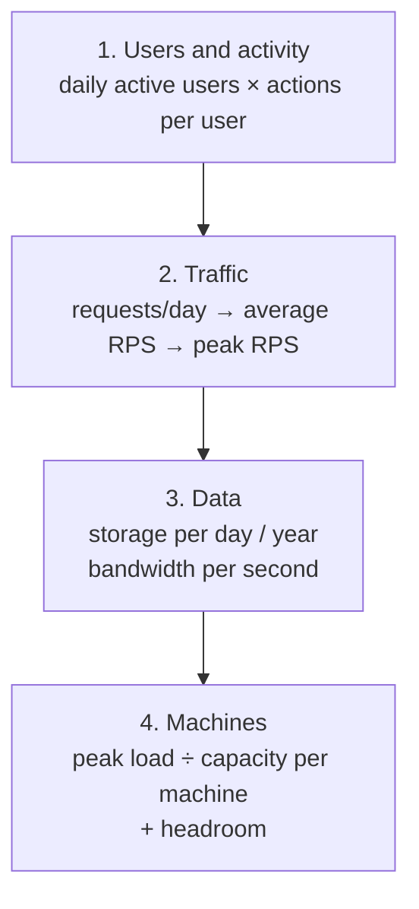

# 02 — Back-of-the-envelope estimation

**How to turn "a million users" into requests per second, storage, bandwidth and machines — fast, out loud, with round numbers.** Interviewers ask for estimates because the numbers decide the design: 10 requests per second fits on one server; 10,000 does not.

The goal is the right **order of magnitude** (is it 10, 1,000 or 100,000?), not precision. Round aggressively and say so: *"call it 100,000 seconds in a day"*.

---

## 1. Numbers to memorise

### Time

| Quantity | Value | Round to |
|---|---|---|
| Seconds in a day | 86,400 | **~10⁵** (100,000) |
| Seconds in a month | ~2.6 million | **~2.5 × 10⁶** |
| Seconds in a year | ~31.5 million | **~3 × 10⁷** |

A useful consequence: **1 million requests per day ≈ 12 requests per second** (1,000,000 ÷ 86,400 ≈ 11.6).

| Per day | ≈ Per second (average) |
|---|---|
| 1 million | ~12 |
| 10 million | ~120 |
| 100 million | ~1,200 |
| 1 billion | ~12,000 |

### Powers of two and sizes

| Power | Exact | Approx. | Name |
|---|---|---|---|
| 2¹⁰ | 1,024 | thousand | KB (kilobyte) |
| 2²⁰ | ~1.05 million | million | MB |
| 2³⁰ | ~1.07 billion | billion | GB |
| 2⁴⁰ | ~1.1 trillion | trillion | TB |
| 2⁵⁰ | — | quadrillion | PB |

| Thing | Typical size |
|---|---|
| a character (ASCII) | 1 byte |
| a UUID | 16 bytes (36 as text) |
| a timestamp | 8 bytes |
| a short text record (tweet, log line) | 100 bytes – 1 KB |
| a web page / JSON response | 10–100 KB |
| a photo | 200 KB – 5 MB |
| a minute of HD video | ~50–100 MB |
| an LLM token as text | ~4 characters ≈ 4 bytes |
| a 1B-parameter model, 4-bit | ~0.8 GB |
| a 7–8B model, 16-bit | ~14–16 GB |
| a 70B model, 16-bit | ~140 GB |

### Latency numbers (approximate, order of magnitude)

| Operation | Time |
|---|---|
| read from CPU cache | ~1 ns |
| read from main memory (RAM) | ~100 ns |
| read 1 MB sequentially from memory | ~10–50 µs |
| SSD random read | ~16–100 µs |
| round trip within a datacenter | ~0.5 ms |
| read 1 MB from SSD | ~0.5–1 ms |
| disk (HDD) seek | ~10 ms |
| round trip across a continent | ~50–100 ms |
| round trip across the world | ~150–250 ms |

What to remember: **memory is ~1,000× faster than a network hop inside a datacenter, which is ~100× faster than a hop across the world.** That is why caches and putting servers near users work.

### Rough capacity of one machine

| Component | Ballpark per instance |
|---|---|
| a web/API server (simple requests) | 1,000–10,000 requests/s |
| a relational database (PostgreSQL) on good hardware | ~1,000–10,000 writes/s; more reads |
| Redis | ~100,000 operations/s |
| a Kafka broker | ~100,000+ messages/s |
| one GPU serving a 7–8B LLM with batching | ~2–10 requests/s, ~1,000–3,000 output tokens/s (depends heavily on lengths) |

These vary by a factor of 10 with hardware and workload. In an interview, state your assumption ("assume one API server handles ~2,000 RPS") and move on.

---

## 2. The method

Every estimate follows the same four steps:



1. **Users and activity.** Daily active users (**DAU**) × actions per user per day = actions per day.
2. **Traffic.** Actions per day ÷ ~100,000 = average per second. **Peak** is higher — multiply by **2–3** for normal daily cycles, more for events. Also note the **read : write ratio** (social feeds are ~100:1 reads).
3. **Data.** Size per item × items per day = storage per day; × 365 × years retained = total. Requests per second × response size = bandwidth.
4. **Machines.** Peak load ÷ capacity of one machine, then add headroom (run at ~50–70% so a spike or a failed machine does not cause an outage).

Say every assumption out loud, write numbers on the board, and keep a "result" column the interviewer can see.

---

## 3. Worked example: a URL shortener

The classic warm-up. Assumptions: **100 million new short links per month**, **100 reads for every write**, each record ~500 bytes, keep for 5 years.

| Quantity | Calculation | Result |
|---|---|---|
| Writes per second | 100,000,000 ÷ (30 × 86,400) | **~40 /s** |
| Reads per second | 40 × 100 | **~4,000 /s** |
| Peak reads | × 3 | ~12,000 /s |
| Storage per month | 100 M × 500 B | 50 GB |
| Storage for 5 years | 50 GB × 12 × 5 | **~3 TB** |
| Unique ids needed | 100 M × 12 × 5 | 6 billion |
| Id length | base62 (a–z, A–Z, 0–9): 62⁷ ≈ 3.5 trillion | **7 characters** is plenty |

**What the numbers tell you:** 40 writes/s is trivial for one database; 12,000 reads/s is not, but the data is read-heavy and never changes — a **cache** in front of the database absorbs most reads. 3 TB fits on one large database, but you would plan sharding if growth continues.

---

## 4. Worked example: an LLM chat API

Same method, with tokens. Assumptions — say them out loud:

- **1 million daily active users**, each sending **20 messages a day**.
- An average request has **1,000 prompt tokens** (system prompt + history + question) and **300 output tokens**.
- Peak traffic is **3×** average.
- One GPU running a 7–8B model with continuous batching handles about **5 requests/s** at our lengths while meeting the latency target.

### Traffic

| Quantity | Calculation | Result |
|---|---|---|
| Requests per day | 1 M × 20 | 20 million |
| Average RPS | 20 M ÷ 86,400 | **~230 /s** |
| Peak RPS | × 3 | **~700 /s** |
| Output tokens per second at peak | 700 × 300 | **~210,000 tok/s** |
| Prompt tokens per second at peak | 700 × 1,000 | ~700,000 tok/s |
| Tokens per day | 20 M × 1,300 | ~26 billion |

### Concurrency

How many answers are being generated *at the same moment*? Use **Little's law**: *in-flight = arrival rate × time each request takes*.

| Quantity | Calculation | Result |
|---|---|---|
| Time per request | ~0.5 s to first token + 300 tokens at ~30 tok/s per stream | ~10.5 s |
| Concurrent streams at peak | 700 /s × 10.5 s | **~7,300** |

### Machines

| Quantity | Calculation | Result |
|---|---|---|
| GPUs needed at peak | 700 ÷ 5 | 140 |
| With headroom (run at 70%) | 140 ÷ 0.7 | **~200 GPUs** |
| Streams per GPU | 7,300 ÷ 200 | ~37 at once — that is why **batching** is essential |
| Output speed per stream | 210,000 tok/s ÷ 7,300 | ~29 tok/s — comfortably above reading speed (~5–8 tok/s) |
| KV-cache memory per GPU | Llama-3-8B: ~128 KB per token × 1,300 tokens × 37 streams | ~6 GB — fits next to 16 GB of weights on an 80 GB GPU |

### Storage and cost

| Quantity | Calculation | Result |
|---|---|---|
| Usage records (billing) | 20 M × ~300 bytes | ~6 GB/day, ~2.2 TB/year |
| Conversation text, if stored | 20 M × 1,300 tokens × ~4 bytes | ~100 GB/day — a privacy decision as much as a storage one |
| GPU cost | ~100 GPUs on average × $2/hour × 730 h | **~$146,000 /month** |
| Cost per 1M output tokens | $146,000 ÷ (6 B × 30 ÷ 1 M) | **~$0.81** |

**What the numbers tell you:**

- The bottleneck is **GPUs**, not web servers or databases: 700 RPS is easy for the API layer and impossible for one GPU.
- **Concurrency is ~7,000**, so each GPU must run dozens of conversations at once → continuous batching is mandatory.
- **KV-cache memory**, not just weights, decides how many conversations fit per GPU.
- **Cost per token** is the business metric; batching, quantisation and caching all exist to lower it.

This exact estimate is the starting point of the [mock interview](04-mock-interview-llm-inference.md).

---

## 5. A worked example from this repository

The same arithmetic with **measured** numbers (one M3 Pro laptop, Gemma-3-1B, from [05-deploy.md](../../05-deploy.md)):

- One request takes ~1.23 s → maximum ~0.81 requests/s on one serial process.
- A team of 200 at peak sends ~0.42 req/s → utilisation 0.42 × 1.23 ≈ 52%… but the latency target ("95% of answers start within 2 s") held only up to ~0.24 req/s.
- So one laptop is not enough *for the latency target*, even though it has enough raw throughput — the lesson of [queueing](#6-queueing-the-one-formula-worth-knowing) below.

---

## 6. Queueing: the one formula worth knowing

**Utilisation** ρ (rho) = arrival rate × service time. At ρ = 1 the server is busy 100% of the time.

For a single server with random arrivals, average time in the system is roughly:

```
time in system ≈ service time ÷ (1 − ρ)
```

| Utilisation | Service time 2 s → time in system |
|---|---|
| 50% | 4 s |
| 80% | 10 s |
| 90% | 20 s |
| 95% | 40 s |

**Lesson:** latency explodes as you approach 100%. That is why capacity plans target **50–70% utilisation**, and why the headroom step in §2 is not optional.

---

## 7. Common mistakes

- **Forgetting peak.** Averages hide the busiest hour; design for peak.
- **Mixing units.** Bits vs bytes (network speeds are in *bits*: 1 Gbps ≈ 125 MB/s), GB vs GiB, per day vs per second.
- **False precision.** "694.4 requests per second" — say "about 700".
- **Not using the numbers.** An estimate is only useful if you say what it implies: "40 writes per second, so one database is fine".
- **Forgetting headroom and failures.** If one of three servers dies, the other two must carry the load.

## 8. Practice

Estimate, then check against the outline in [05-practice-and-flashcards.md](05-practice-and-flashcards.md):

1. A photo-sharing app: 10 M DAU, each uploads 2 photos and views 50 a day. Storage per year? Read RPS?
2. A chat app: 50 M DAU, 40 messages each per day, 100 bytes per message. Writes per second? Storage per year?
3. An LLM coding assistant: 200,000 developers, 100 completions each per day, 2,000 prompt tokens and 50 output tokens each. Peak RPS? Output tokens per second? What dominates — prefill or decode?

Next: [03 — The interview framework](03-interview-framework.md).
