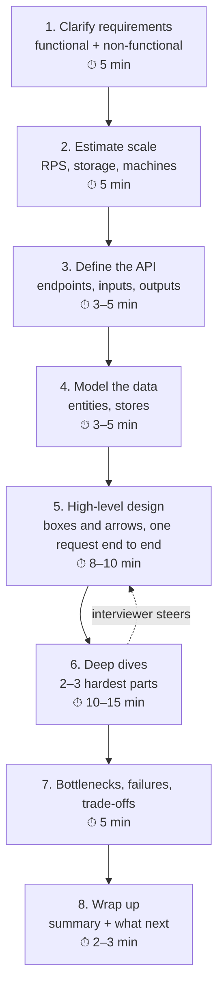

# 03 — The interview framework

**Eight steps that turn a vague prompt into a clear design, with a time plan, what to say at each step, templates to fill in, what interviewers score, and the mistakes that cost the most.**

The prompt will be short and open on purpose — *"Design a chat API for an LLM"*. The interviewer wants to see you shape it into something concrete. The framework is how you do that without freezing or rambling.

---

## 1. The eight steps at a glance



Times are for a 45-minute interview. Steps 1–4 are short but non-negotiable; the deep dives are where most of the score comes from.

---

## 2. Step by step

### Step 1 — Clarify requirements (≈5 min)

**Goal:** turn the vague prompt into a short list of things you will design for, agreed with the interviewer.

Ask about:

| Category | Example questions |
|---|---|
| **Users and use case** | Who are the users — consumers, developers, internal teams? What is the main thing they do? |
| **Core features** | What must it do? What is explicitly *out* of scope? |
| **Scale** | How many users? Requests per day? Growth? |
| **Performance** | What latency is acceptable? (for LLMs: time to first token, streaming speed) |
| **Availability** | How bad is downtime — 99.9%? 99.99%? |
| **Consistency** | Must everyone see the latest data immediately? |
| **Constraints** | Budget, existing infrastructure, regions, regulations, privacy |

Then **write the requirements on the board** in two lists:

```
Functional                         Non-functional
- send prompt, stream answer       - 1M DAU, peak ~700 RPS
- choose a model                   - p95 TTFT < 1 s, ≥ 20 tok/s stream
- see own usage                    - 99.9% availability
                                   - cost per token minimised
Out of scope: training, the UI     - no prompt text stored
```

What the interviewer looks for: you **ask before you design**, you **prioritise** (3–5 core features, not 20), and you **state assumptions** when they say "you decide".

### Step 2 — Estimate scale (≈5 min)

**Goal:** numbers that drive decisions. Use the method from [02-estimation.md](02-estimation.md): users → requests per second (average and peak) → storage and bandwidth → machines.

Keep it to what matters for *this* system. For a URL shortener, read RPS and storage. For an LLM API, peak RPS, tokens per second, concurrency, GPUs and cost. Then **say what the numbers imply**: "~700 RPS is easy for the API tier but needs ~200 GPUs, so GPUs are the design centre."

### Step 3 — Define the API (≈3–5 min)

**Goal:** the contract between clients and your system. A few endpoints, with inputs and outputs.

```
POST /v1/chat/completions
  headers: Authorization: Bearer <api key>
  body:    { model, messages[], max_tokens, temperature, stream }
  returns: stream of tokens (SSE) … then usage { prompt_tokens, completion_tokens }
  errors:  400 bad request, 401 no/invalid key, 429 rate limited, 503 overloaded

GET /v1/usage?start=…&end=…
  returns: { prompt_tokens, completion_tokens, cost } for the caller
```

Mention: authentication, pagination for lists, idempotency keys for writes that may be retried, versioning (`/v1/`), and error codes.

### Step 4 — Model the data (≈3–5 min)

**Goal:** the main entities, their key fields, and which store each lives in — with a reason.

```
Tenant(id, name, plan, limits)                → PostgreSQL (transactions, few rows)
ApiKey(id, tenant_id, hash, scopes, revoked)  → PostgreSQL, cached in memory
UsageEvent(event_id, tenant_id, model,        → append-only store / Kafka → warehouse
           prompt_tokens, completion_tokens, ts)   (billions of rows, write-heavy)
RateLimitCounter(key, tokens, updated)        → Redis (fast, shared, expiring)
ModelWeights(model, version, location)        → object storage
```

Say the access pattern that justifies each choice ("usage is written once and read by tenant and month → partition by tenant and time").

### Step 5 — High-level design (≈8–10 min)

**Goal:** one diagram that shows every major component, and a walk-through of one request from start to end.

Tips:

- Start simple — client → load balancer → service → store — then add components **only when a requirement or a number calls for them**, and say which one.
- **Walk a request through the diagram out loud:** "the request hits the gateway, which checks the key and the rate limit, then…". This is the single most effective thing you can do in this step.
- Mark which paths are synchronous (the user waits) and which are asynchronous (a queue, a background job).

### Step 6 — Deep dives (≈10–15 min)

**Goal:** show depth on the 2–3 parts that are genuinely hard for *this* system. Often the interviewer picks; if not, propose them: "the two hardest parts are GPU scheduling and the rate limiter — shall I go deeper on those?"

For each deep dive:

1. State the problem precisely, with a number.
2. Give two or three options.
3. Compare them on the requirements.
4. Choose one and say why — and what it costs.

Good deep-dive topics: the scheduler/batching for LLMs, the rate limiter, caching strategy, the database schema and sharding, consistency of a counter, the hot-key problem, failure handling.

### Step 7 — Bottlenecks, failures and trade-offs (≈5 min)

Walk the diagram asking, for each component: *what if it is slow? what if it dies? what if load doubles?*

| Check | Example |
|---|---|
| Single points of failure | one load balancer, one database primary, one region |
| Hot spots | one tenant with huge traffic; one popular key |
| Overload | what happens at 2× peak — fast rejection or collapse? |
| Data loss | what if a server crashes mid-request? |
| Dependencies | the moderation service is down — fail open or closed? |

Then name the trade-offs you made, plainly: "I chose eventual consistency for usage counters; the dashboard may be a minute behind, which is fine for this use case."

### Step 8 — Wrap up (≈2–3 min)

Summarise in four or five sentences: the requirements, the key decisions, and what you would do next with more time (monitoring, a second region, cost optimisation). End on a design the interviewer can picture.

---

## 3. A template for your notes

Use this skeleton on the whiteboard or in a document; fill it in step by step.

```
REQUIREMENTS
  Functional:      1)            2)            3)
  Non-functional:  scale ___ | latency ___ | availability ___ | consistency ___
  Out of scope:

ESTIMATES
  DAU ___ × actions ___ = ___ /day  →  avg ___ RPS  →  peak ___ RPS
  storage ___ /day, ___ /year        bandwidth ___
  machines: peak ___ ÷ ___ per machine ÷ 0.7 = ___

API
  METHOD /path   in: ___   out: ___   errors: ___

DATA
  Entity(fields) → store, because ___

DESIGN (diagram)
  client → ___ → ___ → ___

DEEP DIVES
  1) problem ___ | options ___ | choice ___ | cost ___
  2)

RISKS / TRADE-OFFS
  SPOF ___ | overload ___ | failure ___ | trade-off ___
```

---

## 4. Useful phrases

Saying your reasoning out loud is most of the job. Phrases that help:

- Clarifying: *"Before I design, can I check a few things about scale and latency?"*
- Assuming: *"I'll assume 1 million daily users — tell me if you had a different number in mind."*
- Scoping: *"I'll focus on the request path and treat billing as out of scope unless you want it."*
- Using numbers: *"That's about 700 requests per second at peak, so a single database is fine, but GPUs are the bottleneck."*
- Trade-offs: *"Option A is simpler; option B scales further but adds a dependency. Given our scale, I'd start with A."*
- Inviting steering: *"Which part would you like me to go deeper on?"*
- Recovering: *"Actually, that creates a hot spot — let me change the shard key."*

---

## 5. What interviewers score

| Signal | Strong | Weak |
|---|---|---|
| **Requirements** | asks focused questions, agrees scope, writes them down | starts drawing immediately |
| **Estimation** | quick, rounded, and *used* to justify choices | skipped, or precise numbers that change nothing |
| **High-level design** | simple first, every component justified, request walked end to end | a wall of boxes copied from memory |
| **Depth** | knows how 2–3 components really work and their limits | names technologies without explaining them |
| **Trade-offs** | compares options, states costs, chooses with a reason | "use Kafka because it scales" |
| **Failures** | finds single points of failure, plans for overload | assumes everything always works |
| **Communication** | structured, checks in, adapts to hints | silent drawing, or monologue ignoring the interviewer |

Seniority changes the bar: a junior engineer is expected to produce a working design with sensible components; a senior one to lead the conversation, find the real bottleneck early, and reason about operations, cost and evolution.

---

## 6. The ten most common mistakes

1. **Designing before clarifying.** You solve the wrong problem.
2. **Skipping numbers.** Without them, "add a cache" or "shard the database" is a guess.
3. **Over-engineering.** Microservices, Kafka and three databases for 10 requests per second.
4. **Under-engineering.** One server for a million users, with no plan for failure.
5. **Naming instead of explaining.** "Use Redis" — for what, storing what, and what if it is down?
6. **No trade-offs.** Every choice costs something; say what.
7. **Ignoring failure.** Every component fails; say what happens.
8. **Silence.** The interviewer cannot score thinking they cannot hear.
9. **Not listening.** Hints are gifts — "what about very long prompts?" means "go deeper there".
10. **Running out of time** before the deep dives, where most of the credit is.

---

## 7. LLM-specific checklist

When the system serves a model, also cover:

- [ ] Latency split into **time to first token** and **streaming speed**, with targets
- [ ] **Tokens**, not just requests: tokens per second, prompt vs output, context length
- [ ] **GPU capacity**: weights + KV cache memory, throughput per GPU, number of GPUs
- [ ] **Batching** (continuous) as the throughput lever, and its latency cost
- [ ] **Streaming** responses (SSE), and what happens on disconnect
- [ ] **Rate limits in tokens** (TPM) as well as requests (RPM)
- [ ] **Admission control**: a bounded queue and fast 429/503 under overload
- [ ] **Model routing and versions**: several models, canary releases, rollback
- [ ] **Caching**: prefix cache, exact-match response cache
- [ ] **Cost per token**, and the levers: quantisation, smaller models, batching, caching
- [ ] **Safety and privacy**: moderation, prompt storage policy, tenant isolation
- [ ] **Observability**: TTFT, tokens/s, queue depth, GPU utilisation, error rate by code

Next: [04 — Mock interview: design an LLM inference API](04-mock-interview-llm-inference.md).
