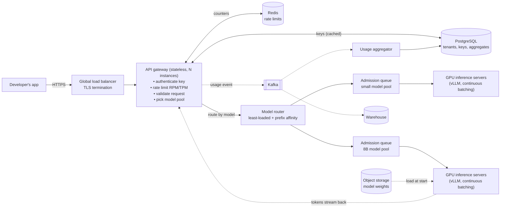
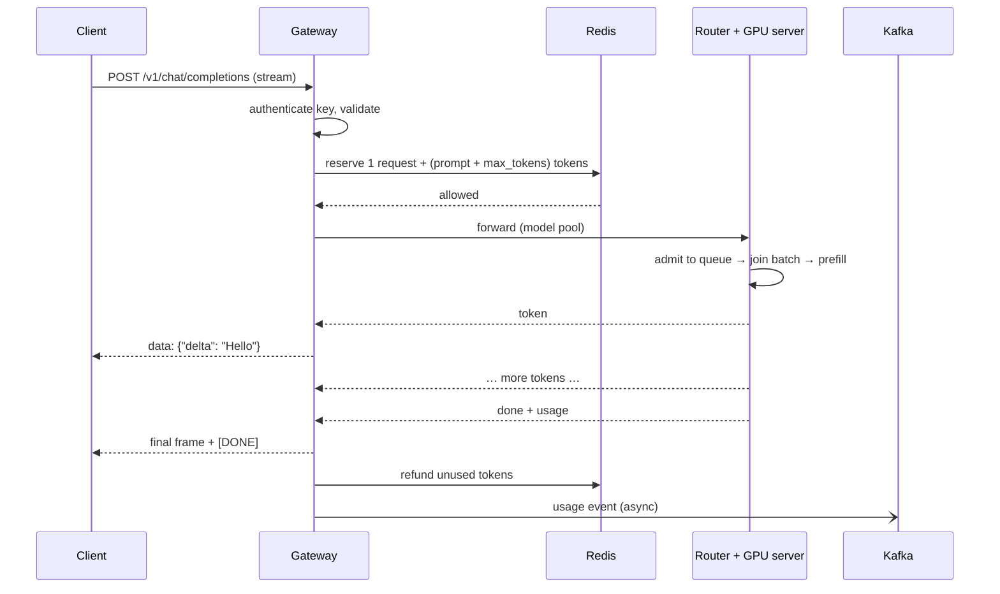
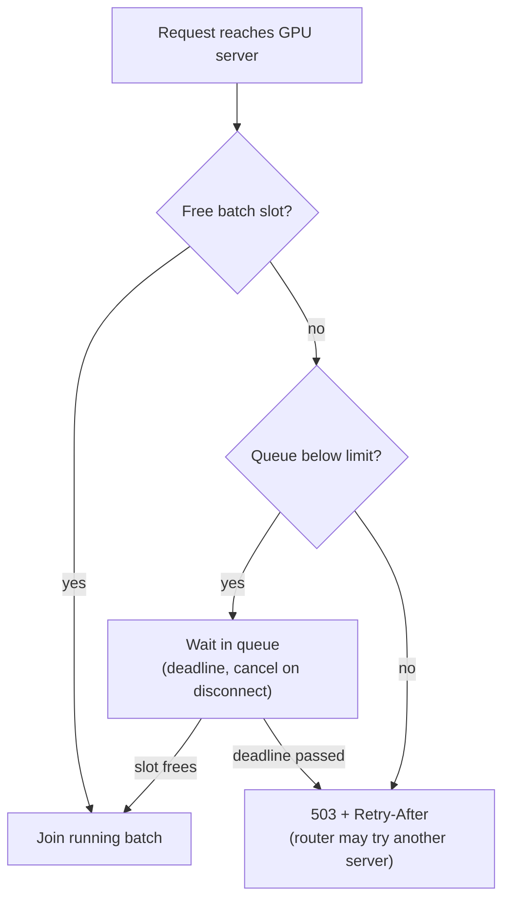

# 04 — Mock interview: design an LLM inference API

**The eight-step framework from [03](03-interview-framework.md), applied end to end to one prompt, with the dialogue, the numbers, the diagrams, the deep dives and the follow-up questions.** At the end, a map from every part of the design to this repository.

Read it twice: once straight through; then again covering each answer and trying the step yourself first.

> **Interviewer:** "Design an API — like OpenAI's — that lets developers send prompts to a large language model and get answers back."

---

## Step 1 — Clarify requirements (5 min)

> **You:** "Before designing, a few questions. Who are the users — our own apps, or external developers paying per token?"
>
> **Interviewer:** "External developers, paying per token."
>
> **You:** "Which models — one, or several sizes?"
>
> **Interviewer:** "A few open-weight models: a small fast one and a 7–8B general one. Assume we host them."
>
> **You:** "Should answers stream token by token, like ChatGPT?"
>
> **Interviewer:** "Yes."
>
> **You:** "Scale — how many users and requests?"
>
> **Interviewer:** "Plan for a million daily active end users across our customers' apps."
>
> **You:** "Latency expectations? For chat, I'd suggest the first token within a second at p95, and streaming at least 20 tokens a second."
>
> **Interviewer:** "Good."
>
> **You:** "Are we storing conversations, or is it stateless — the client sends the history each time?"
>
> **Interviewer:** "Stateless, like OpenAI's chat API. Don't store prompts."
>
> **You:** "And training, fine-tuning and the customer dashboard are out of scope?"
>
> **Interviewer:** "Yes. Focus on serving."

Written on the board:

| Functional | Non-functional |
|---|---|
| 1. send messages, receive a **streamed** answer | **scale:** 1 M DAU (estimate below) |
| 2. choose a model | **latency:** p95 time to first token < 1 s; ≥ 20 tok/s streaming |
| 3. authenticate with an API key | **availability:** 99.9% |
| 4. rate limits per customer | **cost:** minimise $ per token |
| 5. usage metering for billing | **privacy:** no prompt text stored; customers isolated |
| *Out of scope:* training, fine-tuning, dashboard UI | |

---

## Step 2 — Estimate scale (5 min)

> **You:** "Let me size it. I'll assume each user sends 20 messages a day, with about 1,000 prompt tokens — system prompt plus history — and 300 output tokens, and peak is three times average."

| Quantity | Working | Result |
|---|---|---|
| Requests/day | 1 M × 20 | 20 M |
| Average RPS | 20 M ÷ ~86,400 | ~230 |
| **Peak RPS** | × 3 | **~700** |
| Output tokens/s at peak | 700 × 300 | ~210,000 |
| Prompt tokens/s at peak | 700 × 1,000 | ~700,000 |
| Duration of one request | ~0.5 s to first token + 300 tokens at ~30 tok/s | ~10.5 s |
| **Concurrent streams** (Little's law) | 700 × 10.5 | **~7,300** |
| GPUs (assume ~5 req/s per GPU for an 8B model with batching) | 700 ÷ 5 ÷ 0.7 headroom | **~200** |
| Usage records | 20 M/day × ~300 B | ~6 GB/day |
| Cost (≈100 GPUs on average × $2/h × 730 h) | | ~$146 k/month → **~$0.81 per 1M output tokens** |

> **You:** "Three things follow. First, 700 RPS is easy for normal web servers — the GPUs are the bottleneck and the main cost. Second, about 7,000 answers are streaming at any moment, so each GPU must serve dozens at once — continuous batching is required, not optional. Third, because cost per token is the business, everything that raises tokens per GPU — batching, caching, quantisation — matters."

---

## Step 3 — API (4 min)

```http
POST /v1/chat/completions
Authorization: Bearer sk_live_…
Content-Type: application/json

{ "model": "general-8b",
  "messages": [{"role": "system", "content": "…"}, {"role": "user", "content": "…"}],
  "max_tokens": 512, "temperature": 0.7, "stream": true }
```

Streamed response (Server-Sent Events):

```
data: {"choices":[{"delta":{"content":"Hello"}}]}
data: {"choices":[{"delta":{"content":" there"}}]}
data: {"choices":[{"delta":{},"finish_reason":"stop"}],
       "usage":{"prompt_tokens":1012,"completion_tokens":2}}
data: [DONE]
```

| Status | Meaning | Client should |
|---|---|---|
| 200 | streaming | read until `[DONE]` |
| 400 | invalid request, or prompt too long for the context window | fix the request |
| 401 / 403 | missing or invalid key / not allowed for this model | fix the key |
| 429 | rate limit or quota exceeded (`Retry-After` header) | wait and retry |
| 503 | overloaded (`Retry-After`) | retry with backoff |

Also: `GET /v1/models` (list models) and `GET /v1/usage` (the caller's usage).

> **You:** "I'm copying OpenAI's shape on purpose: every existing SDK then works by changing the base URL."

---

## Step 4 — Data model (4 min)

| Entity | Key fields | Store | Why |
|---|---|---|---|
| Tenant (customer) | id, plan, limits (RPM, TPM, monthly tokens) | PostgreSQL | few rows, needs transactions |
| API key | id, tenant_id, **hash** of the secret, scopes, revoked | PostgreSQL, cached in gateway memory | checked on every request |
| Rate-limit counters | per key: request bucket, token bucket, in-flight | **Redis** | shared across gateway instances, fast, expiring |
| Usage event | event_id, tenant, model, prompt/completion tokens, status, time | **Kafka** → data warehouse / ClickHouse | ~20 M/day, append-only, read by tenant and month |
| Usage aggregates | tenant × model × day | PostgreSQL | invoices, quotas |
| Model weights | model, version, files | object storage | gigabytes; downloaded by GPU nodes at start |

> **You:** "Prompts are not stored at all, which matches the privacy requirement and removes the largest data-storage problem."

---

## Step 5 — High-level design (10 min)



**Walk-through of one request**, said out loud:

1. The app sends `POST /v1/chat/completions` over HTTPS; the **load balancer** terminates TLS and forwards to any **gateway** instance — gateways are stateless.
2. The gateway **authenticates** the key (hash lookup, cached in memory), **validates** the request (size, `max_tokens` ceiling, model allowed for this tenant), and checks **rate limits** in Redis: one request from the request bucket, and `prompt_tokens + max_tokens` reserved from the token bucket.
3. The **router** chooses a GPU server in the right model pool — the least loaded one, preferring a server that recently saw the same system prompt (prefix cache).
4. The GPU server's **admission queue** accepts the request if there is room (otherwise a fast 429/503), and the **scheduler** adds it to the running batch at the next token step.
5. Tokens **stream back** through the router and gateway to the client as Server-Sent Events.
6. When the answer ends, the gateway **settles** the rate limit (refunds unused reserved tokens) and publishes a **usage event** to Kafka; aggregators turn events into daily totals for billing and quotas.



---

## Step 6 — Deep dives (15 min)

> **Interviewer:** "Let's go deeper. How do you get enough throughput out of each GPU?"

### Deep dive 1 — GPU serving and batching

**The problem.** Generating one token means reading *all* the model's weights from GPU memory. For an 8B model at 16-bit precision that is ~16 GB per step. A GPU with ~2 TB/s of memory bandwidth can do that ~125 times a second — so **one** conversation gets at most ~125 tokens/s, and the GPU's arithmetic units sit almost idle while it waits for memory.

**Options.**

| Option | How | Result |
|---|---|---|
| One request at a time | simple | ~1 request per GPU at a time; ~7,300 streams would need thousands of GPUs |
| Static batching | wait to collect B requests, run them together to the end | better throughput, but short answers wait for long ones, new arrivals wait for the whole batch |
| **Continuous batching** | the batch is re-formed at **every token step**: finished requests leave, new ones join | high throughput *and* low waiting — the standard (vLLM, TGI, TensorRT-LLM) |

**Why it works.** Reading the weights once can advance many conversations: B conversations per step cost little more than one, until the GPU's compute or memory fills. Throughput per GPU rises several-fold; each stream gets a little slower, but stays far above reading speed.

**What limits the batch: KV-cache memory.** Each conversation keeps a KV cache — Llama-3-8B needs ~128 KB per token, so a 1,300-token conversation is ~170 MB. On an 80 GB GPU with ~16 GB of weights, ~60 GB is left for caches → room for ~350 such conversations in theory; in practice fewer, because contexts vary and memory fragments. **Paged attention** (vLLM) allocates cache in small blocks on demand, which roughly doubles how many sequences fit compared with reserving the maximum length for each.

**Long prompts.** A 30,000-token prompt can stall everyone's tokens while it is prefilled. **Chunked prefill** splits it into pieces interleaved with other requests' decode steps.

> **You:** "So each GPU server runs vLLM with continuous batching and paged attention, configured with a maximum batch size chosen by load testing — the largest that keeps p95 streaming speed above 20 tokens a second. That's what makes ~5 requests per second and ~37 concurrent streams per GPU realistic."

### Deep dive 2 — Rate limiting

> **Interviewer:** "A customer sends one huge request after another. How do you protect everyone else?"

**Problem.** Requests differ in cost by 1000×, so counting requests is not enough.

**Design.**

- Two **token buckets** per API key in Redis: **RPM** (requests per minute) and **TPM** (tokens per minute), plus an **in-flight** cap (max concurrent requests).
- **Reserve and refund:** at admission, reserve `prompt_tokens + max_tokens`; when the answer ends, refund what was not used. Example: reserve 1,500 + 512 = 2,012; the answer used 300 → refund 212.
- **Atomic** check-and-update across all three limits in one Redis Lua script, so a rejection by one limit does not consume another.
- On rejection: **429** with `Retry-After` and `x-ratelimit-*` headers (SDKs back off automatically).
- **Redis down?** Fail *open* with per-gateway local limits (limit ÷ number of gateways) and alert — a Redis outage should not become a full outage.
- **Quotas** (monthly tokens) come from the usage aggregates, plus a live counter for today.

Full design: [02-rate-limiting-and-quotas.md](../02-rate-limiting-and-quotas.md).

### Deep dive 3 — Overload and admission control

> **Interviewer:** "What happens at twice the expected peak?"

**Problem.** Without a limit, requests queue on the GPU servers; every user's first token gets later and later — with 7,300 active streams, an unbounded queue can mean minutes of waiting, and clients time out while the GPUs keep working on answers nobody reads.

**Design.**

- A **bounded queue per GPU server**: accept while `waiting < max_waiting`, else return **503 with `Retry-After`** immediately. Size it from the latency budget: each GPU server completes ~5 requests per second, so a slot frees about every 0.2 s; allowing ~1 s of waiting gives ~5 waiting requests per server.
- **Deadlines:** drop requests that have waited longer than the client will.
- **Cancellation:** when a client disconnects, stop generating its answer and free the slot.
- **Priority:** paid tiers ahead of free tiers when shedding.
- **Autoscaling** on queue depth and GPU KV-cache utilisation — not CPU — with headroom, because a new GPU node takes minutes (provision, download weights, load, warm up).



---

## Step 7 — Bottlenecks, failures and trade-offs (5 min)

| Risk | What happens | Mitigation |
|---|---|---|
| A GPU server dies | its streams are cut | client sees an error frame and retries; router stops sending (health checks); spare capacity |
| A whole region fails | outage there | multi-region deployment with DNS/global LB failover (weights already in each region) |
| Redis down | no shared rate limits | fail open with local per-gateway limits; alert |
| Kafka down | usage events stop | gateway buffers events on local disk and replays; event ids make replays safe (idempotent) |
| A hot customer | others slow down | per-tenant rate limits, in-flight caps, fair queueing |
| New model version is worse | quality regression | canary release (1–5% of traffic), evaluation set, quick rollback |
| Traffic spike | queues fill | admission control + autoscaling with headroom |
| Very long prompts | stalls a batch | context limits per plan; chunked prefill |

**Trade-offs made:**

- **Batching:** much higher throughput and lower cost per token, at the price of slightly slower individual streams.
- **Eventual consistency for usage:** dashboards and quotas may lag by seconds or a minute; billing is reconciled from the event log.
- **Fail-open rate limits:** availability over strict enforcement during a Redis outage.
- **Stateless API:** clients resend history (more prompt tokens), but any server can answer any request and nothing sensitive is stored.

---

## Step 8 — Wrap up (2 min)

> **You:** "To summarise: an OpenAI-compatible streaming API for about 700 requests per second at peak. Stateless gateways handle authentication, token-based rate limits in Redis and usage events to Kafka. A router sends each request to a pool of GPU servers per model, preferring servers with a warm prefix cache. Each server runs continuous batching with paged attention, behind a bounded admission queue that sheds load with 503s instead of letting latency explode. That gives about 200 GPUs at peak and roughly 80 cents per million output tokens. With more time I'd add a second region, a response cache for repeated prompts, speculative decoding for latency, and a smaller distilled model for simple requests to cut cost."

---

## Follow-up questions interviewers ask — with short answers

| Question | Answer outline |
|---|---|
| *How would you cut cost by half?* | quantise to 8-bit or 4-bit (less memory → bigger batches); route easy requests to the small model; prefix caching for shared system prompts; response cache for identical requests at temperature 0; buy reserved/spot GPUs for baseline/batch traffic |
| *How do you serve a 70B model?* | it does not fit on one GPU at 16-bit (~140 GB) → tensor parallelism across 2–8 GPUs on one node, or quantisation; fewer, larger servers |
| *How do you lower time to first token?* | prefix cache, shorter prompts, chunked prefill, admission control so requests do not queue, servers in regions near users |
| *A customer needs guaranteed capacity.* | dedicated replicas (a reserved pool) and a higher limit tier; priority in admission queues |
| *How do you roll out a new model version safely?* | evaluate offline; shadow traffic; canary 1–5%; compare error rates, latency, output length and quality signals; promote gradually; keep the old version for rollback |
| *How do you handle a client that disconnects?* | detect the closed connection, cancel generation, free the batch slot, bill only tokens generated |
| *How would you add moderation?* | an input classifier before generation; for output, check streamed text in windows and stop with `finish_reason: content_filter`; per-tenant policy; fail-closed or fail-open is a product decision |
| *Why not store conversations server-side?* | privacy and storage; stateless servers are simpler to scale; prefix caching recovers most of the cost of resending history |
| *How do you know the system is healthy?* | SLIs: p95 time to first token, streaming tokens/s, error rate by code, queue depth, GPU KV-cache utilisation; burn-rate alerts on SLOs |

---

## How this maps to this repository

shilp is a single-machine version of the **GPU inference server** box in the diagram, with parts of the gateway inside it. What it has and what the design above needs:

| Component in the design | In shilp | Where to read more |
|---|---|---|
| OpenAI-compatible streaming API | ✅ both OpenAI and Ollama shapes, SSE/NDJSON | [00-current-state.md](../00-current-state.md) |
| Status codes, error frames mid-stream, cancellation on disconnect | ✅ | [architecture.md](../../architecture.md) |
| Usage records per request | 🟡 no tenant, no event log | [06-metering-and-billing.md](../06-metering-and-billing.md) |
| API key authentication | ⬜ | [01-authentication.md](../01-authentication.md) |
| Rate limits (RPM/TPM, Redis) | ⬜ | [02-rate-limiting-and-quotas.md](../02-rate-limiting-and-quotas.md) |
| Bounded admission queue | ⬜ (requests wait without a limit) | [03-admission-control.md](../03-admission-control.md) |
| Continuous batching | ⬜ (one request at a time per model) | [04-batching-and-concurrency.md](../04-batching-and-concurrency.md) |
| Router, replicas, health checks | ⬜ | [05-replicas-and-load-balancing.md](../05-replicas-and-load-balancing.md) |
| Tenancy, moderation, isolation | ⬜ | [07-multi-tenancy-and-abuse.md](../07-multi-tenancy-and-abuse.md) |
| Load testing to find capacity | ✅ `scripts/loadtest.py` | [07-operate.md](../../07-operate.md) |

The measured behaviour of shilp is the clearest illustration of *why* batching matters: four simultaneous requests on one laptop started at 0, 1.6, 3.2 and 4.7 seconds, each at full speed, with total throughput flat ([05-deploy.md §4.3](../../05-deploy.md)). That is the "one request at a time" row of deep dive 1, measured.

Next: [05 — Practice questions and flashcards](05-practice-and-flashcards.md).
