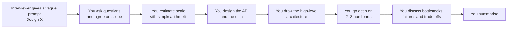

# System design for interviews — a beginner's track

**Start here if you are new to system design.** This track teaches the vocabulary, the building blocks, the arithmetic and the step-by-step method interviewers expect, and then applies all of it to one complete worked interview: designing an LLM inference API — the system this repository is a small version of.

The rest of [docs/system-design/](../README.md) is an engineering plan for shilp. This track is the *interview* view of the same ideas: how to reason about them out loud, in 45 minutes, on a whiteboard.

---

## The documents

| # | Document | What you learn | Time to read |
|---|---|---|---|
| 1 | [01 — Building blocks and definitions](01-building-blocks.md) | every term you will hear — latency, throughput, availability, scaling, load balancers, caches, databases, replication, sharding, queues, consistency, CAP — each defined, drawn and given an example | 2–3 h |
| 2 | [02 — Back-of-the-envelope estimation](02-estimation.md) | the numbers to memorise and the method to turn "1 million users" into requests per second, storage, bandwidth and machines | 1 h |
| 3 | [03 — The interview framework](03-interview-framework.md) | the eight steps of a system design interview, with a flowchart, a time plan, templates, what interviewers score, and common mistakes | 1 h |
| 4 | [04 — Mock interview: design an LLM inference API](04-mock-interview-llm-inference.md) | the framework applied end to end, with numbers, diagrams, deep dives and follow-up questions — and how each part maps to shilp | 1–2 h |
| 5 | [05 — Practice questions and flashcards](05-practice-and-flashcards.md) | questions to practise with answer outlines, and quick-recall definitions | ongoing |

---

## How a system design interview works

- **Length:** usually 45–60 minutes.
- **Format:** a conversation and a drawing — on a whiteboard, or a shared tool such as Excalidraw. Usually no code.
- **There is no single right answer.** The interviewer scores *how* you reason: whether you clarify before designing, whether your numbers justify your choices, whether you see trade-offs, and whether you communicate clearly.
- **Two flavours** you may meet:
  - *Classic* system design: a URL shortener, a chat app, a news feed, a rate limiter.
  - *ML / LLM* system design: serving a model, a recommendation system, a RAG pipeline. Same method, with extra concerns — GPU capacity, latency per token, cost per token, model quality and safety.

---

## A study plan

| Week | Do |
|---|---|
| 1 | Read [01](01-building-blocks.md) slowly. For every building block, say out loud *what problem it solves* and *what it costs*. Re-draw each diagram from memory. |
| 2 | Learn the numbers in [02](02-estimation.md). Do every worked example yourself, then invent three of your own. Read [03](03-interview-framework.md) and learn the eight steps by heart. |
| 3 | Read the mock interview [04](04-mock-interview-llm-inference.md) twice: once straight through, once covering the answers and trying each step yourself. |
| 4+ | Practise with [05](05-practice-and-flashcards.md): one question per day, timed at 45 minutes, out loud, drawing as you go. Use the flashcards for 10 minutes a day. |

Practise *out loud*. The skill being tested is explaining a design while you build it, and that only improves with speaking.

---

## How to read the diagrams

The flowcharts use [Mermaid](https://mermaid.js.org/), which GitHub and most editors render as pictures. The conventions:

| Shape | Meaning |
|---|---|
| `["box"]` | a component or a step |
| `{"diamond"}` | a decision |
| `[("cylinder")]` | a data store |
| `-->` | a request or a flow |
| `-.->` | an asynchronous flow (a message, a background job) |

If your viewer does not render Mermaid, paste a block into [mermaid.live](https://mermaid.live) to see it.

---

## How this connects to the rest of the repository

| When the interview talks about… | In this repository |
|---|---|
| the request path of an LLM API | [06-service-fundamentals.md §1](../../06-service-fundamentals.md) and [00-current-state.md](../00-current-state.md) |
| rate limiters, queues, batching, replicas, metering | the design documents [01](../01-authentication.md)–[07](../07-multi-tenancy-and-abuse.md) |
| capacity numbers that were actually measured | [05-deploy.md §4](../../05-deploy.md) and [07-operate.md §1–2](../../07-operate.md) |
